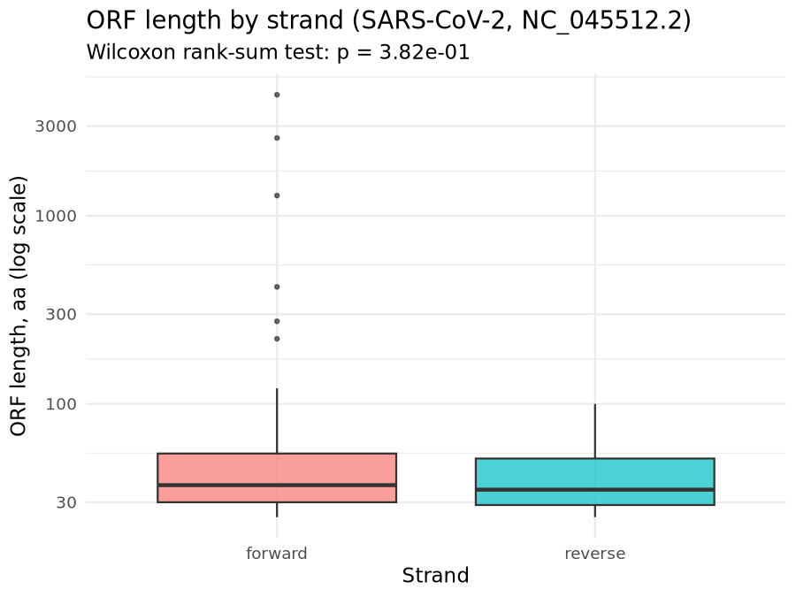

# Translation and Open Reading Frame Discovery Across Five Independent Genomic Contexts

## Overview

This repository implements five independent, reproducible analyses in computational molecular biology, each testing a distinct aspect of DNA-to-protein translation and open-reading-frame (ORF) discovery:

1. **Reference-validated CDS translation** of the *Transposon Tn3* (*E. coli*, GenBank `V00613`) transposase gene (`tnpA`), using the bacterial genetic code and the record's own annotated translation as ground truth.
2. **Six-frame ORF scanning** of a padded genomic window around the SARS-CoV-2 spike gene (`NC_045512.2`), recovering the correct reading frame from raw sequence alone.
3. **Dual genetic-code translation** of the human mitochondrial *COX1* (*MT-CO1*) coding sequence (`NC_012920.1`), contrasting the standard and vertebrate mitochondrial codon tables to quantify the effect of four reassigned codons.
4. **Six-frame ORF scanning** of the pUC19 cloning plasmid (`L09137`), recovering two of its real genes (*bla*/AmpR and *lacZα*) from the reverse strand of a sequence fetched and scanned as if linear.
5. **Genome-scale ORF-length asymmetry testing** of the full SARS-CoV-2 genome (`NC_045512.2`, 29,903 bp), comparing forward- and reverse-strand ORF-length distributions with a Wilcoxon rank-sum test.

Each analysis fetches its own input programmatically from NCBI at runtime via Biopython's `Entrez` module; no notebook depends on another's output except the Example 5 pair, where the R half consumes a CSV written by the Python half.

---

## Repository Architecture

```
bioinfo-translation-orf/
├── 01_example1_tn3_translation.ipynb          # tnpA CDS translation + reference validation
├── 02_example2_spike_sixframe_orf.ipynb       # Six-frame scan, SARS-CoV-2 spike region
├── 03_example3_cox1_mitochondrial_code.ipynb  # Standard vs. mitochondrial genetic code
├── 04_example4_puc19_orf_finding.ipynb        # Six-frame scan, pUC19 plasmid
├── 05_example5_orf_length_asymmetry_py.ipynb  # Full-genome ORF-length extraction (Python half)
├── 05_example5_orf_length_asymmetry_r.ipynb   # Wilcoxon test + ggplot2 boxplot (R half)
├── environment.yml                            # Conda/mamba environment specification
├── .gitignore
├── data/                                      # Fetched GenBank/FASTA records (generated at runtime)
│   └── .gitkeep
└── results/                                   # Analysis outputs: tables, summaries, figures
    ├── .gitkeep
    ├── example1_tnpA_protein.fasta
    ├── example1_tnpA_summary.txt
    ├── example2_spike_orfs.csv
    ├── example3_cox1_code_comparison.txt
    ├── example4_puc19_orfs.csv
    ├── example5_orf_lengths.csv
    └── example5_orf_length_boxplot.png
```

`data/` is excluded from version control (`.gitignore` ignores `data/*`, keeping only the placeholder); every file under `results/` listed above is tracked and regenerated verbatim by the notebook that produces it.

---

## Environment & Prerequisites

| Component | Version | Role |
|---|---|---|
| Python | 3.11 | Sequence retrieval, six-frame ORF scanning, codon-table translation |
| R | 4.3 | Wilcoxon rank-sum hypothesis testing, visualization |
| Biopython | 1.83 | NCBI `Entrez` access, `Seq`/`SeqRecord` parsing and translation, `CodonTable` lookups |
| ggplot2 | 3.5.0 | Log-scaled boxplot of the forward/reverse ORF-length comparison |
| IRkernel | — | R kernel registration for Jupyter/VS Code |

**Editor:** [Visual Studio Code](https://code.visualstudio.com/), with the Python extension (`ms-python.python`), the Jupyter extension (`ms-toolsai.jupyter`), and the R extension (`REditorSupport.r`).

**Setup:**

```bash
mamba env create -f environment.yml
conda activate bioinfo-skill3-translation-orf
R -e 'IRkernel::installspec()'   # register the R kernel once
```

Open the project folder in VS Code and select the matching kernel per notebook (Python for notebooks 01–04 and the Python half of 05; R for the R half of 05). A valid contact e-mail must be set in `Entrez.email` before running any notebook — this is a requirement of the NCBI E-utilities usage policy, not an optional parameter.

---

## Workflow Pipeline

```
01_example1_tn3_translation.ipynb
    Entrez.efetch(V00613, rettype="gb") → CDS matched by protein_id CAA23884.1 (tnpA)
    → translate(table=11, cds=True) → validate against annotated reference translation
    [independent]

02_example2_spike_sixframe_orf.ipynb
    Entrez.efetch(NC_045512.2, seq_start=21400, seq_stop=25450) → 4,051 bp window
    → 3-frame scan per strand (min 100 aa) → results/example2_spike_orfs.csv
    [independent]

03_example3_cox1_mitochondrial_code.ipynb
    Entrez.efetch(NC_012920.1, seq_start=5904, seq_stop=7445) → 1,542 bp CDS
    → translate(table=1) and translate(table=2) on the same sequence
    → results/example3_cox1_code_comparison.txt
    [independent]

04_example4_puc19_orf_finding.ipynb
    Entrez.efetch(L09137) → 2,686 bp plasmid, scanned as linear
    → 3-frame scan per strand (min 80 aa) → results/example4_puc19_orfs.csv
    [independent]

05_example5_orf_length_asymmetry_py.ipynb  (run first)
    Entrez.efetch(NC_045512.2, full record) → 29,903 bp genome
    → 3-frame scan per strand (min 25 aa), every ORF length retained
    → results/example5_orf_lengths.csv
        │
        ▼
05_example5_orf_length_asymmetry_r.ipynb  (run second)
    read.csv(results/example5_orf_lengths.csv)
    → wilcox.test(length_aa ~ strand) → results/example5_orf_length_boxplot.png
```

Only the Example 5 pair has a dependency: the Python half must be executed before the R half, since the R notebook reads the CSV the Python notebook writes. Every other notebook runs standalone from a clean kernel.

---

## Core Findings

**1. The annotated *tnpA* translation reproduces exactly.** Extracting the CDS tagged `protein_id="CAA23884.1"` from the Tn3 record (3,048 bp) and translating it under the bacterial genetic code (table 11) yields a 1,015 aa protein — an exact match to the record's own annotated reference translation, beginning `MLKKPSGREADMPVDFLTTEQVESYGRFTG…` and ending `…KEASEAENVA`. This confirms correct CDS extraction and translation-table selection against ground truth, independent of any BLAST or homology step.

**2. A naive six-frame scan recovers the spike reading frame from raw sequence alone.** Scanning all three forward and three reverse frames of a 4,051 bp window around the spike gene (`NC_045512.2:21400–25450`) at a 100 aa minimum finds exactly one qualifying ORF: a 1,282 aa open reading frame on the forward strand in frame +2 (nt 136–3,985). No ORF of comparable length appears on the reverse strand, consistent with this region's genes being encoded entirely on the deposited (positive) strand.

**3. The vertebrate mitochondrial code rescues 508 additional codons in the *COX1* CDS.** Translating the same 1,542 bp (514-codon) CDS under the standard code (table 1) terminates after only 5 aa, at the CDS's first internal `TGA`, which is a stop codon under the standard code but reassigned to tryptophan under the vertebrate mitochondrial code (table 2); under table 2 translation proceeds to the full 513 aa. Codon-level accounting over the whole CDS: `AGA` occurs once (Arg → Stop), `AGG` zero times, `ATA` 25 times (Ile → Met), and `TGA` 16 times (Stop → Trp) — the last of these being the specific codon responsible for the standard-code translation's premature termination.

**4. Two real pUC19 genes are independently recovered from the reverse strand.** Scanning the 2,686 bp plasmid sequence (fetched and scanned as linear, so an ORF spanning the circular origin at position 2,686/1 would be missed) at an 80 aa minimum finds four qualifying ORFs, two of which match canonical pUC19 annotations by length to the residue: a 286 aa reverse-strand ORF (861 bp, reverse frame 3) matching *bla*/AmpR, and a 107 aa reverse-strand ORF (324 bp, reverse frame 1) matching *lacZα*. The remaining two hits (118 aa and 88 aa, both forward strand) are shorter incidental ORFs below any known annotated gene in this plasmid.

**5. Forward-strand ORFs include one dramatic outlier, but the full-distribution asymmetry test is not significant.** Scanning the complete 29,903 bp genome at a 25 aa minimum finds 79 ORFs on the forward strand and 80 on the reverse strand. The single longest forward ORF is 4,405 aa — consistent with *ORF1a*, the SARS-CoV-2 replicase polyprotein, which this linear scan can translate up to its own in-frame stop codon but cannot extend into the ~7,096 aa ORF1ab fusion, since that requires a programmed ribosomal −1 frameshift that no `translate()`-based scan reproduces. By contrast, the longest reverse-strand ORF is only 100 aa. Despite this striking maximum-length asymmetry — and despite the forward set's third-largest ORF (1,282 aa) exactly reproducing the independent Example 2 finding above — a two-sided Wilcoxon rank-sum test over the complete length distributions gives **W = 3,414.0, p = 3.82 × 10⁻¹**: not significant at any conventional threshold. This is explained by the distributions' medians, computed directly from the published `results/example5_orf_lengths.csv`: 37 aa (forward, n = 79) versus 35 aa (reverse, n = 80) — nearly identical, because the 25 aa threshold admits large numbers of short, non-coding ORFs by chance on both strands, and a rank-based test is driven by where the bulk of the distribution sits, not by a handful of extreme values. The forward strand's few genuinely long ORFs (4,405 / 2,595 / 1,282 / 419 / 275 aa) are real signal, but at n = 79 vs. n = 80 they are too few, relative to the noise floor on both strands, to shift the rank-sum statistic into significance. This is itself a useful methodological result: a visually obvious asymmetry in the *maximum* of two distributions does not guarantee a significant difference in the distributions as a whole, and the choice of summary statistic (max vs. rank-based location) materially changes the conclusion.



*Per-ORF length (log scale) by strand, SARS-CoV-2 full genome, 25 aa minimum. Boxes and medians nearly overlap; only the forward strand's upper outliers (driven by ORF1a and a handful of other large real ORFs) separate visually, which the rank-sum test (p = 3.82 × 10⁻¹) does not register as significant. Generated by `05_example5_orf_length_asymmetry_r.ipynb`.*

---

## Usage & Execution

```bash
# 1. Clone and enter the repository
git clone https://github.com/mohammed-alabbasi/bioinfo-translation-orf.git
cd bioinfo-translation-orf

# 2. Build and activate the environment
mamba env create -f environment.yml
conda activate bioinfo-skill3-translation-orf
R -e 'IRkernel::installspec()'

# 3. Run each notebook from VS Code (or any Jupyter front end), selecting the
#    correct kernel per file. Example 5 must be run in order:
#       05_example5_orf_length_asymmetry_py.ipynb   (Python kernel)
#       05_example5_orf_length_asymmetry_r.ipynb    (R kernel)
#    All other notebooks (01, 02, 03, 04) can be run independently, in any order.
```

Each notebook creates its own `data/` and `results/` outputs on first run; no manual directory setup is required beyond the environment build above.
